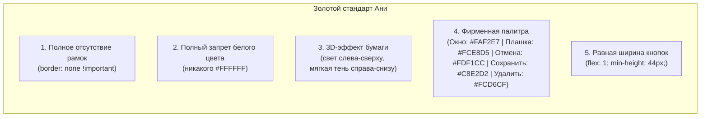

# ИНЖЕНЕРНЫЙ ПЛАН СТЕЙДЖА 4: ЭКРАН «КЛИЕНТЫ»
# Проект: «Мои таблицы ♡»
**Стейдж:** 4 из 5  
**Версия:** 2.0 (после Plan Review v3, Раунд 1 — устранены замечания DEF-3.1, DEF-3.2, DEF-3.3, DEF-3.4)  
**Статус:** Готово к независимому Plan Review v3 (Раунд 2, уровни 1–3)  
**Цель:** Создать 100% живой экран «Клиенты» с разноцветными карточками клиентов, 4 официальными статусами («Обсуждение», «В работе», «Ожидает», «Завершён»), автоматическим опусканием завершённых клиентов в самый низ списка, канонической нормализацией статусов и данных из Google Таблиц, удобным фильтром-переключателем в шапке, полным отсутствием строки поиска, адаптивным 2-колоночным Master-Detail интерфейсом с автовыбором активного досье (десктоп) и полноэкранной анкетой (телефон), быстрым звонком и умной ссылкой WhatsApp (с автозаменой `8` на `7`), экранированием ведущего плюса в номерах телефонов для защиты Google Таблиц от `#ERROR!`, реактивным обновлением плашки «Клиенты» на Главном экране и модальными окнами по Золотому стандарту Ани.

---

## 1. ЦЕЛИ И АРХИТЕКТУРА СТЕЙДЖА 4

### 1.1. Что входит в Стейдж 4:

1. **4 официальных статуса клиентов и каноническая нормализация (DEF-3.1):**
   - **«Обсуждение»** (`discuss`): медово-жёлтый фон бейджа `#FDF1CC`, текст `#5B481D`;
   - **«В работе»** (`work`): нежно-мятный фон бейджа `#C8E2D2`, текст `#1E3F30`;
   - **«Ожидает»** (`waiting`): пастельно-персиковый фон бейджа `#FCD6CF`, текст `#58241B`;
   - **«Завершён»** (`done`): серо-песочный фон бейджа `#EADBCC`, текст `#6B5B49`.
   - Каждый статус имеет аккуратную световую точку-индикатор и мягкий контрастный текст без резких рамок;
   - Каноническая функция `canonicalStatus(rawStatus)` гарантирует безошибочный маппинг любых вариантов («В работе», «Завершён», «Завершен», «Ожидает», «Обсуждение», `work`, `done`, `waiting`, `discuss`) к единому канону.

2. **Автоматическая сортировка (Завершённые ВСЕГДА внизу):**
   - Клиенты со статусом «Завершён» (`done`) автоматически опускаются в самый низ списка карточек, чтобы не отвлекать внимание от текущих активных дел;
   - Клиенты со статусами «Обсуждение», «В работе» и «Ожидает» находятся в верхней рабочей зоне;
   - Внутри групп сохраняется стабильный хронологический порядок;
   - Сортировка пересчитывается автоматически при изменении статуса клиента в анкете или модалке.

3. **Фильтр-переключатель статусов в шапке:**
   - Горизонтальный переключатель в виде тактильных бумажных таблеток:
     * **Все** (показывает всех неархивных клиентов, завершённые внизу);
     * **В работе** (только активные заказы);
     * **Ожидает** (клиенты на паузе / ожидающие материалы или оплату);
     * **Обсуждение** (новые заявки и переговоры);
     * **Завершён** (успешно сданные проекты).
   - Активный фильтр визуально выделяется объёмной бумажной плашкой с мягкой тенью (`box-shadow`), без черных или искусственных ободков;
   - При отсутствии клиентов в выбранном фильтре отображается тактильная плашка пустого состояния («Нет клиентов в этом статусе ♡»).

4. **Полное отсутствие строки поиска:**
   - В строгом соответствии с ТЗ и принципом чистоты («клиентов немного, экран чистый и просторный») поисковая строка `search-box` и инпуты `search-input` полностью удалены со страницы клиентов на десктопе и на телефоне.

5. **Адаптивный интерфейс и жизненный цикл Master-Detail (DEF-3.3):**
   - **Десктопный вид (Master-Detail, 2 колонки):**
     * *Слева (колонка шириной 360–390px):* кнопка «+ Добавить клиента», панель фильтров статусов и вертикальный скролл разноцветных карточек клиентов;
     * *Справа (просторная область анкеты):* подробное досье выбранного в левом списке клиента, окрашенное в его пастельный цвет (мята, персик, лаванда, небо, сливки), без лишних вкладок и белого фона;
     * *Жизненный цикл выбора:* при первом входе автоматически выбирается первый доступный неархивный клиент из отфильтрованного списка; при удалении/архивации выбранного клиента выбор автоматически переключается на следующего доступного клиента; если клиентов нет — отображается тактильная плашка-заглушка («Выберите клиента слева ♡» или «Список клиентов пуст ♡»);
     * Выбранная карточка слева визуально выделяется мягким вдавливанием и деликатным свечением.
   - **Мобильный вид (iPhone 390×844):**
     * *Режим 1 (Список клиентов):* компактные разноцветные карточки с круглым аватаром-инициалами, именем, проектом, статусом и телефоном. Кнопка «+ Клиент» в шапке;
     * *Режим 2 (Полноэкранная анкета):* при тапе на любую карточку анкета выбранного клиента открывается на весь экран. В шапке анкеты крупная удобная кнопка «← Назад к списку» (сенсорная зона $\ge 44\times 44\text{px}$).

6. **Поля анкеты клиента и интерактивные действия (DEF-3.4):**
   - **Имя клиента:** крупный выразительный заголовок;
   - **Телефон:** отображение номера с быстрыми действиями:
     * Клик по номеру: прямой вызов через `tel:...`;
     * Кнопка перехода в WhatsApp: прямая ссылка `https://wa.me/<digits>` (`target="_blank"`); при этом функция `getWhatsAppUrl` автоматически заменяет ведущую `8` на `7` для 11-значных российских номеров (`8900...` $\rightarrow$ `https://wa.me/7900...`);
     * Кнопка быстрого копирования номера в буфер обмена (`navigator.clipboard.writeText`);
     * **Экранирование для Google Таблиц:** при сохранении в базу ведущий знак `+` всегда экранируется одинарным апострофом (`"'+79001234567"`), что гарантирует 100% защиту от сбоев формул `#ERROR!` в Google Таблицах; при отображении в UI апостроф аккуратно отсекается;
   - **Проект / Услуга:** название выполняемой работы или сервиса;
   - **Статус клиента:** бейдж одного из 4 статусов с возможностью быстрого переключения;
   - **Ссылка на CRM / Таблицы:** кликабельная внешняя ссылка на рабочую CRM или диск заказчика (`target="_blank" rel="noopener noreferrer"`);
   - **Доступы и пароли:** поле с временными доступами или ссылкой на менеджер паролей; оснащено кнопкой «глазок» для показа/скрытия пароля и кнопкой копирования в буфер;
   - **Заметка:** блок для важных договорённостей, дедлайнов и комментариев;
   - **Цвет клиента:** выбор пастельного цвета карточки (мята `#C8E2D2`, персик `#FCD6CF`, лаванда `#DBCCE9`, небо `#D3E7F8`, сливки `#FDF1CC`, коралл `#FCD6CF`).

7. **Модальные окна строго по Золотому стандарту Ани:**
   - **Модалка «+ Новый клиент»:**
     * Поля: Имя (обязательное), Телефон, Проект, Статус (селектор из 4 вариантов), CRM-ссылка, Доступы/Пароли, Заметка, Палитра цветов (ряд тактильных кружочков с галочкой);
     * Кнопки равной ширины (`flex: 1; min-height: 44px;`): [ Отмена ] (тёплые сливки `#FDF1CC`, текст `#5B481D`) и [ Сохранить ] (нежная мята `#C8E2D2`, текст `#1E3F30`);
     * `border: none`, отсутствие `#FFFFFF`, объём за счёт мягких 3D-теней;
   - **Модалка «✎ Редактировать клиента»:**
     * Позволяет изменить любые поля клиента;
     * 3 кнопки равной ширины (`flex: 1; min-height: 44px;`):
       1. [ Удалить ] — пастельный коралл `#FCD6CF`, текст `#58241B`;
       2. [ Отмена ] — тёплые сливки `#FDF1CC`, текст `#5B481D`;
       3. [ Сохранить ] — нежная мята `#C8E2D2`, текст `#1E3F30`.
   - **Подтверждение удаления (Архивация):**
     * При нажатии «Удалить» всплывает подтверждение по стандарту Ани («Удалить клиента из списка? Данные сохранятся в истории. [ Отмена ] [ Удалить ]»);
     * Клиент помечается `В_Архиве: TRUE` и скрывается из активного списка.

8. **Реактивная связь с Главным экраном:**
   - Плашка «Клиенты» на Главном экране (`#desk-clients-count` на десктопе и `#mob-clients-count` на телефоне) отображает количество клиентов со статусом **«В работе»** (`work`);
   - Любое изменение клиента (добавление со статусом «В работе», смена статуса на «В работе» или с него, архивация) немедленно и реактивно вызывает `updateSummaryCards()` и актуализирует счетчик Главного экрана.

---

### 1.2. Что НЕ входит в Стейдж 4 (границы изоляции):

- Главный экран, интерактивный календарь и карточки оплат в календаре (Стейдж 1);
- Экран «Расходы» и логика автосброса подписок 1-го числа (Стейдж 2);
- Экран «Доходы», полная стоимость проектов и учет проектных транзакций (Стейдж 3);
- Официальный Google Gate вход, токены доступа и OAuth2-валидация (Стейдж 5);
- Прямая отправка сообщений через API мессенджеров (используются исключительно нативные протоколы `tel:` и `https://wa.me/`).

---

## 2. СТРУКТУРА ХРАНЕНИЯ В GOOGLE ТАБЛИЦАХ И АДАПТЕР ДАННЫХ

Схема данных листа `Клиенты` полностью согласована с `ТЗ_Мои_Таблицы.md` и бэкендом синхронизации:

### Лист: `Клиенты`
| Колонка | Имя в коде | Тип | Обязательное | Описание и валидация |
|---|---|---|---|---|
| `A` | `ID` | string | Да | Уникальный ключ клиента (`cli_...`), генерируется автоматически |
| `B` | `Имя` | string | Да | Имя клиента (не пустое, обрезка пробелов `trim()`) |
| `C` | `Телефон` | string | Нет | Номер телефона; при записи ведущий `+` обязательно экранируется апострофом `'` (`"'+79001234567"`) |
| `D` | `Проект` | string | Нет | Название проекта, услуги или задачи |
| `E` | `Статус` | string | Да | Кодовый статус: `discuss` \| `work` \| `waiting` \| `done` (хранится в нижнем регистре) |
| `F` | `CRM_Ссылка` | string | Нет | URL ссылки на рабочую CRM или Google Таблицы клиента |
| `G` | `Пароли` | string | Нет | Временный пароль или ссылка на программу хранения паролей |
| `H` | `Заметка` | string | Нет | Текст важных договорённостей с клиентом |
| `I` | `Цвет` | string | Да | Hex-код цвета карточки (по умолчанию мята `#C8E2D2` или выбранный из палитры) |
| `J` | `В_Архиве` | boolean | Да | `FALSE` для активных клиентов, `TRUE` для удалённых (мягкое удаление) |

### 2.1. Функция-адаптер нормализации клиента `normalizeClient(item)` (DEF-3.2):
Чтобы гарантировать прозрачную совместимость между строками из Google Таблиц (с русскими ключами) и объектами фронтенда (camelCase), внедряется универсальный адаптер:

```javascript
function normalizeClient(item) {
  if (!item) return null;
  var id = String(item.id || item.ID || '').trim();
  var name = String(item.name || item['Имя'] || '').trim();
  var phone = String(item.phone || item['Телефон'] || '').trim();
  var project = String(item.project || item['Проект'] || '').trim();
  var rawStatus = item.status || item['Статус'] || 'discuss';
  var status = canonicalStatus(rawStatus);
  var crmUrl = String(item.crmUrl || item['CRM_Ссылка'] || '').trim();
  var passwords = String(item.passwords || item['Пароли'] || '').trim();
  var notes = String(item.notes || item['Заметка'] || '').trim();
  var color = String(item.color || item['Цвет'] || '#C8E2D2').trim();
  
  var isArchived = Boolean(
    item.isArchived === true ||
    item['В_Архиве'] === true ||
    String(item['В_Архиве']).toUpperCase() === 'TRUE'
  );

  return {
    id: id,
    name: name,
    phone: phone,
    project: project,
    status: status,
    crmUrl: crmUrl,
    passwords: passwords,
    notes: notes,
    color: color,
    isArchived: isArchived
  };
}
```

### Модель объекта клиента в памяти (JavaScript State):
```javascript
{
  id: "cli_1729720000_1",
  name: "Анна Смирнова",
  phone: "'+7 900 123-45-67", // В хранилище с апострофом
  project: "Разработка сайта",
  status: "work",              // Канонический статус: 'discuss' | 'work' | 'waiting' | 'done'
  crmUrl: "https://trello.com/b/example",
  passwords: "site_admin: temporaryPass123",
  notes: "Договорились сдать первый этап до конца месяца",
  color: "#C8E2D2",            // Пастельный цвет карточки
  isArchived: false            // Флаг архивации
}
```

---

## 3. ЗОЛОТОЙ СТАНДАРТ ДИЗАЙНА И ИНТЕРФЕЙСА (УТВЕРЖДЁН АНЕЙ)

Интерфейс строго соответствует правилам `AGENTS.md`, `ГАЙД_СТИЛЯ_МОИ_ТАБЛИЦЫ.md` и решениям Ани:



### 3.1. Таблица стилей для 4 официальных статусов:
| Статус (UI) | Код | Фон бейджа | Цвет текста | Световая точка | Значение |
|---|---|---|---|---|---|
| **Обсуждение** | `discuss` | `#FDF1CC` (медово-жёлтый) | `#5B481D` | `#D4A72C` | Идут первые переговоры, согласование ТЗ |
| **В работе** | `work` | `#C8E2D2` (нежная мята) | `#1E3F30` | `#2D9C5E` | Проект в активной работе (учитывается на Главной) |
| **Ожидает** | `waiting` | `#FCD6CF` (пастельный персик) | `#58241B` | `#D9534F` | Ожидание оплаты, материалов или ответа от клиента |
| **Завершён** | `done` | `#EADBCC` (серо-песочный) | `#6B5B49` | `#9B8A78` | Проект сдан, карточка автоматически внизу |

### 3.2. Десктопная Master-Detail спецификация:
- **Контейнер экрана:** фон `#FAF2E7`, максимальная ширина 1440px;
- **Шапка экрана:** заголовок `Клиенты ♡` с аккуратным сердечком `#E3743B`, справа кнопка добавления клиента «+ Добавить клиента» (мята `#C8E2D2`, скругление 16px, `border: none`, сенсорная зона $44\text{px}$);
- **Панель фильтров:** ряд круглых бумажных плашек `[ Все ] [ В работе ] [ Ожидает ] [ Обсуждение ] [ Завершён ]`;
- **Левая колонка списка (Master):**
  * Ширина: 380px;
  * Карточки клиентов в своих цветах (мята, персик, небо, лаванда, сливки);
  * В карточке: аватар-круг с инициалами, имя, проект, телефон и бейдж статуса;
  * Завершённые клиенты всегда внизу с деликатной прозрачностью `opacity: 0.85`;
  * Клик по карточке делает её активной (парящий эффект, мягкая тень, подсветка контура тенью).
- **Правая область досье (Detail):**
  * Полноразмерная карточка-досье, окрашенная в цвет выбранного клиента;
  * Верхняя плашка: имя, проект, аватар, бейдж статуса, кнопка редактирования `✎` (круглая бумажечка);
  * Блок связи: номер телефона крупно, кнопка прямого звонка `tel:`, кнопка WhatsApp `wa.me/`, кнопка копирования в буфер;
  * Блок CRM: адрес CRM / Таблицы с кнопкой быстрого перехода `↗ Открыть CRM`;
  * Блок «Доступы и пароли»: скрытый пароль (по умолчанию `••••••••`), глазок для просмотра и кнопка копирования;
  * Блок «Заметка»: просторное поле важных договоренностей на мягкой сливочной бумажечке `#FAF2E7`;
  * **Заглушка отсутствия выбора:** если список пуст или клиент не выбран — отображается аккуратная тактильная плашка `#FCE8D5` («Выберите клиента слева ♡»).

### 3.3. Мобильная спецификация (390×844):
- **Список клиентов:**
  * Компактный вертикальный стек карточек с сенсорной высотой не менее 56px;
  * Фильтры прокручиваются горизонтально без задержек;
  * Тап по карточке мгновенно открывает полноэкранную анкету;
- **Полноэкранная анкета:**
  * Кнопка «← Назад к списку» в верхнем левом углу (высота 44px, фон `#FDF1CC`, текст `#5B481D`, `border: none`);
  * Крупные сенсорные кнопки быстрого звонка (`tel:`) и WhatsApp шириной во весь экран;
  * Кнопка редактирования «✎ Изменить анкету» для вызова модалки редактирования.

---

## 4. АЛГОРИТМЫ И ИНЖЕНЕРНАЯ ЛОГИКА

### 4.1. Каноническая нормализация статуса `canonicalStatus(rawStatus)` (DEF-3.1):
Исключает любые сбои из-за несовпадения регистра, русских/английских названий или буквы «ё»:

```javascript
function canonicalStatus(rawStatus) {
  if (!rawStatus) return 'discuss';
  var s = String(rawStatus).trim().toLowerCase();
  
  if (s === 'work' || s === 'в работе') return 'work';
  if (s === 'done' || s === 'завершён' || s === 'завершен') return 'done';
  if (s === 'waiting' || s === 'ожидает') return 'waiting';
  if (s === 'discuss' || s === 'обсуждение') return 'discuss';
  
  return 'discuss'; // Безопасный дефолт
}
```

### 4.2. Алгоритм автоматической сортировки (Завершённые внизу):
Для гарантированного размещения клиентов со статусом `done` внизу списка используется стабильная функция сортировки:

```javascript
function sortClients(clientsList) {
  if (!Array.isArray(clientsList)) return [];
  return clientsList.slice().sort(function (a, b) {
    var aNorm = normalizeClient(a);
    var bNorm = normalizeClient(b);
    var aDone = (aNorm && aNorm.status === 'done');
    var bDone = (bNorm && bNorm.status === 'done');

    // Завершённые опускаются вниз
    if (aDone && !bDone) return 1;
    if (!aDone && bDone) return -1;

    // Внутри групп сохраняется исходный порядок добавления
    return 0;
  });
}
```

### 4.3. Алгоритм фильтрации по статусу:
```javascript
function filterClients(clientsList, activeFilter) {
  var normalizedList = (clientsList || []).map(normalizeClient).filter(function (c) {
    return c && !c.isArchived;
  });
  var sorted = sortClients(normalizedList);
  if (!activeFilter || activeFilter === 'all' || activeFilter === 'Все') {
    return sorted;
  }
  var targetCanonical = canonicalStatus(activeFilter);
  return sorted.filter(function (c) {
    return c.status === targetCanonical;
  });
}
```

### 4.4. Жизненный цикл выбора в Master-Detail на десктопе (DEF-3.3):
```javascript
var masterDetailState = {
  selectedClientId: null,
  currentFilter: 'all'
};

// 1. Инициализация экрана десктопа или смена фильтра
function updateMasterDetailSelection(clientsList) {
  var available = filterClients(clientsList, masterDetailState.currentFilter);
  
  var currentSelectedExists = available.some(function (c) {
    return c.id === masterDetailState.selectedClientId;
  });

  if (!currentSelectedExists) {
    if (available.length > 0) {
      // Автовыбор первого доступного клиента
      selectClient(available[0].id);
    } else {
      // Сброс в заглушку, если список пуст
      masterDetailState.selectedClientId = null;
      renderDetailPlaceholder("Нет клиентов в этом статусе ♡");
    }
  } else {
    // Обновляем текущее отображение выбранного клиента
    renderClientDetail(masterDetailState.selectedClientId);
  }
}

// 2. Обработка архивации/удаления клиента
function handleClientArchived(archivedId, clientsList) {
  var client = clientsList.find(function (c) { return (c.id || c.ID) === archivedId; });
  if (client) {
    if (typeof client.isArchived !== 'undefined') client.isArchived = true;
    client['В_Архиве'] = true;
  }

  // Если удален текущий выбранный клиент, переключаем выбор
  if (masterDetailState.selectedClientId === archivedId) {
    var available = filterClients(clientsList, masterDetailState.currentFilter);
    if (available.length > 0) {
      selectClient(available[0].id);
    } else {
      masterDetailState.selectedClientId = null;
      renderDetailPlaceholder("Выберите клиента слева ♡");
    }
  }

  // Реактивное обновление счетчика Главной
  if (window.MyTablesCalendar && typeof window.MyTablesCalendar.updateSummaryCards === 'function') {
    window.MyTablesCalendar.updateSummaryCards();
  }
}
```

### 4.5. Защита формул Google Таблиц и ссылка на WhatsApp с заменой 8 на 7 (DEF-3.4):
Google Таблицы интерпретируют строки с ведущим `+` как формулу и падают в `#ERROR!`. Кроме того, WhatsApp требует международный формат (`7...` вместо `8...` для РФ):

```javascript
// 1. Экранирование для сохранения в базу
function sanitizePhoneForStorage(phoneInput) {
  if (!phoneInput) return '';
  var str = String(phoneInput).trim();
  if (str.charAt(0) === "'") return str;
  if (str.charAt(0) === '+') return "'" + str;
  return str;
}

// 2. Отображение в UI
function displayPhone(phoneRaw) {
  if (!phoneRaw) return '';
  var str = String(phoneRaw).trim();
  if (str.charAt(0) === "'") return str.slice(1);
  return str;
}

// 3. Извлечение только цифр
function getCleanPhoneDigits(phoneRaw) {
  var displayed = displayPhone(phoneRaw);
  return displayed.replace(/\D/g, '');
}

// 4. Генерация ссылки на WhatsApp (DEF-3.4)
function getWhatsAppUrl(phoneRaw) {
  var digits = getCleanPhoneDigits(phoneRaw);
  if (!digits) return '';
  
  // Если номер РФ из 11 цифр начинается с 8 — заменяем на 7
  if (digits.length === 11 && digits.charAt(0) === '8') {
    digits = '7' + digits.slice(1);
  } else if (digits.length === 10) {
    digits = '7' + digits;
  }
  
  return 'https://wa.me/' + digits;
}
```

### 4.6. Реактивная синхронизация с Главным экраном:
Функция расчета сводки `calcSummaryMetrics` в `calendar.js`:
```javascript
var activeClientsCount = clientsList.reduce(function (count, rawItem) {
  var item = normalizeClient(rawItem);
  if (!item || item.isArchived) return count;
  if (item.status === 'work') {
    return count + 1;
  }
  return count;
}, 0);
```
При любом действии с клиентом (добавление, сохранение изменений, смена статуса, удаление) вызывается:
```javascript
if (window.MyTablesCalendar && typeof window.MyTablesCalendar.updateSummaryCards === 'function') {
  window.MyTablesCalendar.updateSummaryCards();
}
```
Это синхронно актуализирует счетчики `#desk-clients-count` и `#mob-clients-count` («X в работе»).

---

## 5. ПЛАН ТЕСТИРОВАНИЯ (TDD)
Файл тестов: `tests/stage4_clients.test.js`  
Запуск: `node tests/stage4_clients.test.js`

План содержит **12 исчерпывающих проверок**:

1. `test_client_creation_and_validation`:
   - Проверка создания клиента с обязательным полем `Имя` и дефолтным статусом `discuss` / `work`;
   - Отклонение пустого имени клиента (`trim().length === 0`);
   - Проверка генерации уникального `ID` с префиксом `cli_`;
   - Назначение цвета из палитры (по умолчанию `#C8E2D2`).

2. `test_normalize_client_adapter`: (DEF-3.2)
   - Проверка `normalizeClient` со строкой Google Таблицы: `{ ID: 'cli_1', Имя: 'Анна', Телефон: "'+79001234567", Проект: 'Сайт', Статус: 'В работе', В_Архиве: 'FALSE' }`;
   - Проверка `normalizeClient` с JS camelCase объектом: `{ id: 'cli_1', name: 'Анна', status: 'work', isArchived: false }`;
   - Проверка корректного распознавания строковых значений `В_Архиве: 'TRUE'` и булевых `true`.

3. `test_canonical_status_normalization`: (DEF-3.1)
   - Проверка маппинга русских и английских строк:
     * `canonicalStatus('В работе') === 'work'` и `canonicalStatus('work') === 'work'`;
     * `canonicalStatus('Завершён') === 'done'` и `canonicalStatus('Завершен') === 'done'`;
     * `canonicalStatus('Ожидает') === 'waiting'` и `canonicalStatus('waiting') === 'waiting'`;
     * `canonicalStatus('Обсуждение') === 'discuss'` и `canonicalStatus('discuss') === 'discuss'`;
   - Проверка нечувствительности к регистру и пробелам (`"  В РАБОТЕ  "` $\rightarrow$ `'work'`);
   - Безопасный возврат `'discuss'` при неизвестном или пустом статусе.

4. `test_phone_apostrophe_and_whatsapp_url_8_to_7`: (DEF-3.4)
   - Проверка экранирования: `sanitizePhoneForStorage('+7 900 123-45-67') === "'+7 900 123-45-67"`;
   - Проверка отображения в UI: `displayPhone("'+7 900 123-45-67") === "+7 900 123-45-67"`;
   - Проверка замены `8` на `7` в WhatsApp: `getWhatsAppUrl('8 (900) 123-45-67') === 'https://wa.me/79001234567'`;
   - Проверка корректной ссылки для `+7`: `getWhatsAppUrl('+7 900 123-45-67') === 'https://wa.me/79001234567'`;
   - Исключение дублирования апострофов при повторном сохранении.

5. `test_auto_sort_done_clients_to_bottom`:
   - Массив из 5 клиентов: 1 — `done`, 2 — `work`, 3 — `waiting`, 4 — `done` («Завершен»), 5 — `discuss`;
   - После `sortClients()` клиенты со статусом `done` гарантированно находятся на позициях 3 и 4 (в самом низу);
   - Клиенты 2, 3 и 5 сохраняют относительный порядок в верхней части.

6. `test_status_filter_switching`:
   - Проверка фильтрации по ключам: `all`, `work`, `waiting`, `discuss`, `done` (а также по русским названиям через `canonicalStatus`);
   - Проверка вызова состояния Empty State при выборе фильтра, где нет записей.

7. `test_no_search_box_in_dom`:
   - Проверка DOM: на экране клиентов отсутствуют элементы `.search-box`, `.search-input` и плейсхолдеры «Поиск клиента...»;
   - Интерфейс чистый и просторный.

8. `test_desktop_master_detail_selection_lifecycle`: (DEF-3.3)
   - Проверка автоматического выбора первого доступного клиента при начальной загрузке экрана;
   - Проверка автоматического переключения на следующего доступного клиента при удалении/архивации текущего выбранного;
   - Проверка отображения тактильной плашки-заглушки («Выберите клиента слева ♡»), если не осталось ни одного активного клиента.

9. `test_mobile_dossier_navigation`:
   - На мобильном экране по умолчанию отображается контейнер списка (`#mobile-client-list-view`);
   - При клике на карточку клиента контейнер списка скрывается (`display: none`), отображается контейнер анкеты (`#mobile-client-dossier-view`);
   - Клик по кнопке «← Назад» возвращает контейнер списка (`display: block`) и скрывает анкету.

10. `test_golden_standard_clients_modals`:
    - Проверка модалок «+ Новый клиент» и «✎ Редактировать клиента» на соблюдение Золотого стандарта Ани:
      * Фон окна: `#FAF2E7`, радиус 24px, отсутствие рамок (`border: none`);
      * Внутренние плашки полей: `#FCE8D5`, радиус 18px;
      * Кнопка «Отмена»: тёплые сливки `#FDF1CC`, текст `#5B481D`, `flex: 1`, `min-height: 44px;`;
      * Кнопка «Сохранить»: нежная мята `#C8E2D2`, текст `#1E3F30`, `flex: 1`, `min-height: 44px;`;
      * Кнопка «Удалить»: пастельный коралл `#FCD6CF`, текст `#58241B`, `flex: 1`, `min-height: 44px;`;
      * Полный запрет чисто белого цвета `#FFFFFF` и темного `#5A4E40` на кнопках действия.

11. `test_reactive_main_screen_counter_sync`:
    - Добавление клиента со статусом `work` увеличивает `activeClientsCount` на 1;
    - Перевод клиента из `work` в `done` уменьшает `activeClientsCount` на 1;
    - Обновление элементов `#desk-clients-count` и `#mob-clients-count` текстом `X в работе`.

12. `test_client_soft_delete_archive`:
    - Нажатие «Удалить» в модалке редактирования выставляет клиенту `isArchived: true` (`В_Архиве: TRUE`);
    - Удалённый клиент немедленно исключается из активного списка и фильтров;
    - Запись сохраняется в хранилище для истории;
    - Если удалённый клиент имел статус `work`, реактивно уменьшается счетчик Главного экрана.

---

## 6. КРИТЕРИИ ПРИЁМКИ СТЕЙДЖА 4

1. **Ревью плана:** Инженерный план Стейджа 4 успешно проверен и одобрен субагентом в рамках навыка `/loop-plan-review-3` (уровни 1–3, оценка $\ge 9.5/10$, критических замечаний 0).
2. **Макет:** Автономный HTML-макет экрана «Клиенты ♡» (десктопная Master-Detail панель + мобильный вид 390×844 со списком и анкетой) подготовлен и показан Ане.
3. **Утверждение Ани:** Получено прямое слово Ани: **«Одобряю»**. До этого слова переход к написанию рабочего кода строго запрещён.
4. **TDD-тесты:** Все 12 тестов в `tests/stage4_clients.test.js` полностью написаны и успешно выполняются (100% pass).
5. **Ревью кода:** Пройден цикл `/loop-code-review-3` (уровни 1–4, критических замечаний 0).
6. **Живая проверка в браузере:** Корректное переключение фильтров, автоматический сброс завершённых в низ списка, работа модалок без рамок и реактивное обновление плашки Главного экрана подтверждены в браузере.
